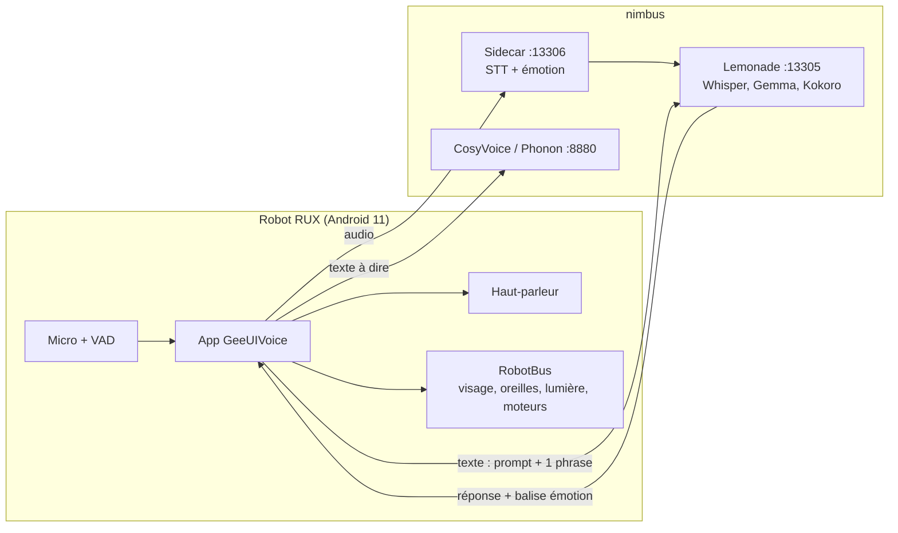
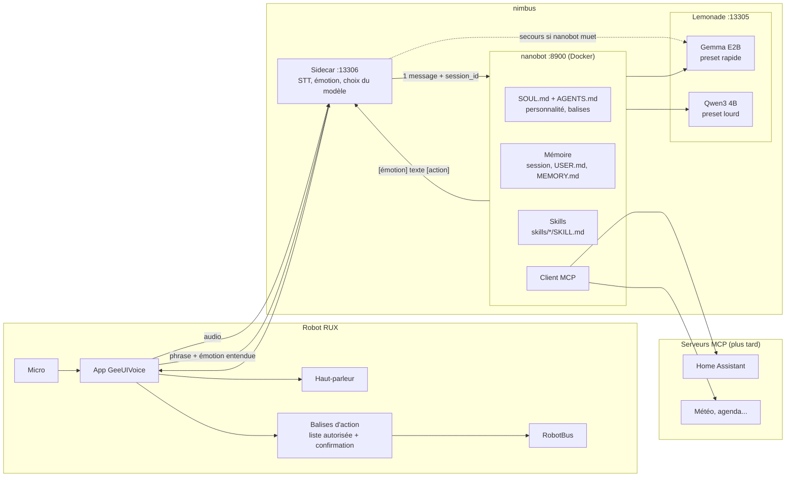
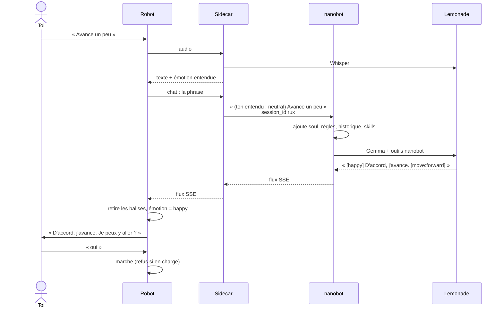

# Donner de l'autonomie au robot avec nanobot

Proposition d'architecture. Le déploiement est prêt dans [`deploy/nanobot/`](../deploy/nanobot/README.md), mais le sidecar et l'app ne sont pas encore modifiés.

Principe : on ne code pas d'agent nous-mêmes. [nanobot](https://github.com/HKUDS/nanobot) (MIT, Python) tourne sur nimbus et devient le cerveau du robot : soul, mémoire, skills, MCP. Le sidecar garde la détection d'émotion et lui transmet les phrases. Le robot garde la voix et exécute les actions qu'on lui renvoie sous forme de balises. Tout reste compatible OpenAI.

## 1. Aujourd'hui

Limites : le robot oublie tout entre deux phrases, et il n'agit que sur des phrases exactes (« avance », « photo »…).

## 2. Cible

L'app parle seulement au sidecar, comme aujourd'hui pour le STT. Changer de modèle, de carte (AMD, NVIDIA, NPU) ou de soul ne touche pas au robot.

## 3. Un tour de conversation

## 4. Gemma pour parler, Qwen3 pour réfléchir

Ce que nanobot sait faire (vérifié dans son code) :
- Des **presets** de modèles nommés (`modelPresets`), ici `rapide` (Gemma) et `lourd` (Qwen3), tous deux sur Lemonade.
- La commande **`/model lourd`** envoyée comme une phrase normale à l'API change le modèle de cette session seulement, et le choix reste jusqu'à `/model rapide`. Testé.
- **`fallbackModels: ["lourd"]`** : si Gemma échoue, nanobot réessaie avec Qwen3.
- **Dream** (la mise à jour des souvenirs) a son propre modèle : `dream.modelOverride: "lourd"`. Testé avec `/dream`.

Ce qu'il ne sait pas faire : ses sous-agents (`subagent`) reprennent le modèle de l'agent principal, sans option pour en choisir un autre. Il n'y a donc pas de délégation native vers Qwen3.

Choix retenu, le plus simple :
1. nanobot reste sur `rapide` (Gemma) par défaut.
2. Le **sidecar** repère une demande lourde (mots comme « réfléchis », « explique », « prépare », « planifie », « résume », « apprends à », ou une phrase longue). Il envoie alors `/model lourd`, puis la phrase, puis `/model rapide`, dans la même session. L'historique reste partagé.
3. Le robot dit d'abord « Je réfléchis… » pour masquer l'attente.
4. Le soir, un cron envoie `/dream`, qui tourne sur Qwen3.

Lemonade doit garder les deux modèles chargés : `lemonade config set max_loaded_models=2`.

## 5. Mémoire

| Niveau | Contenu | Où (workspace nanobot) | Qui l'écrit |
|---|---|---|---|
| Conversation | Les échanges de la session `rux` | `sessions/` | nanobot, à chaque tour |
| Résumés | Les vieux échanges, compressés | `memory/history.jsonl` | nanobot, quand la conversation devient longue ou sur `/compact` |
| Souvenirs | Qui tu es, tes goûts (`USER.md`), faits durables (`memory/MEMORY.md`) | fichiers Markdown, versionnés en git | Dream seulement (`/dream`), avec `/dream-log` et `/dream-restore` |

On peut lire et corriger ces fichiers à la main sur nimbus. « Oublie ça » à la voix n'est pas encore prévu : à faire avec un petit skill.

## 6. Soul et skills

- **`SOUL.md`** : la personnalité de RUX, sa façon de parler (phrases courtes, pas de markdown) et la balise d'émotion au début, mot pour mot comme `FRENCH_EMOTION_SYSTEM_PROMPT` dans l'app. Il remplace le prompt écrit dans l'app.
- **`AGENTS.md`** : les balises d'action autorisées. Elles sont séparées de la soul, parce que Dream peut retoucher `SOUL.md`.
- **Skills** : `skills/<nom>/SKILL.md`, avec un `name` et une `description` en en-tête. nanobot ne met que les descriptions dans le prompt. Le skill intégré `skill-creator` permet d'en créer à la voix : « apprends à faire le réveil du matin ». Le robot relit le skill en une phrase et demande confirmation avant de l'enregistrer.
- **Admin** : pour commencer, on modifie les fichiers à la main. La WebUI de nanobot (port 8765) demande de lancer aussi son `gateway`, à voir plus tard.

## 7. Actions du robot

nanobot ne peut pas toucher le robot : ses outils tournent sur nimbus. Il écrit une **balise d'action à la fin de sa réponse**, et l'app l'exécute.

| Balise | Action dans l'app (`SkillRouter`) | Confirmation |
|---|---|---|
| `[move:forward]` | `actin` 98 | oui, à la voix |
| `[move:back]` | `actin` 64 (non validé sur le robot) | oui |
| `[home]` | `goHome` | oui |
| `[volume:up]` / `[volume:down]` | `volumeUp` / `volumeDown` | non |
| `[photo]` | `takePhoto` | non |
| `[light:<couleur>]`, `[light:off]` | `antennaLight` | non |

Règles appliquées par l'app, pas par le modèle :
- Toute autre balise est ignorée et retirée du texte. `reboot`, `shutdown` et l'ouverture d'apps ne sont jamais accessibles.
- Pour marcher ou rentrer à la base, le robot demande « Je peux y aller ? ». Seul un « oui » dans les 10 secondes lance l'action, sinon elle est annulée.
- Le robot refuse de marcher pendant la charge (déjà en place).
- Les phrases exactes de `SkillLexicon` restent un raccourci immédiat, sans LLM ni confirmation.

## 8. Sécurité

- nanobot tourne en Docker, en utilisateur non root, sans capacités Linux. Son API n'écoute que sur la boucle locale de nimbus, avec une clé.
- Pas de shell (`tools.exec.enable: false`), pas de web, fichiers limités au workspace. Les skills qui ont besoin du shell (github, tmux, clawhub…) sont désactivés.
- Serveurs MCP ajoutés un par un, avec `enabledTools` pour ne garder que les outils voulus.
- Pas de skills téléchargés (ClawHub désactivé).

## 9. Ce qu'il reste à coder

**Sidecar** (`emo_server.py`) :
1. Si `NANOBOT_URL` est défini, `/v1/chat/completions` n'envoie à nanobot que la dernière phrase de l'utilisateur, sans le message système. Il ajoute devant l'émotion entendue, le `session_id` `rux` et la clé `NANOBOT_API_KEY`, puis il relaie le flux.
2. Le choix du modèle : `/model lourd` avant une demande lourde, `/model rapide` après.
3. Le secours : si nanobot ne répond pas, ou si le flux se termine sans `[DONE]`, il renvoie la requête d'origine à Lemonade.

**App** :
1. Envoyer le chat au sidecar plutôt qu'à Lemonade, avec un réglage pour revenir à Lemonade en direct.
2. Lire les balises d'action, les retirer du texte avant la synthèse vocale (aujourd'hui `[move:forward]` serait lu à voix haute), les filtrer avec la liste ci-dessus et les envoyer à `SkillRouter`.
3. Gérer la confirmation vocale pour la marche et le retour à la base.
4. Allonger le délai de réponse, et faire dire « Je réfléchis… » quand la réponse tarde.

## 10. Étapes

1. Sur nimbus : vérifier avec `curl` que Gemma et Qwen3 renvoient des `tool_calls`, y compris en streaming. Si Gemma FLM échoue, passer sur `Gemma-4-E2B-it-GGUF` ou `E4B`.
2. Lancer nanobot (`deploy/nanobot`), tester avec `curl`, mesurer la latence.
3. Sidecar vers nanobot, puis les balises d'action et la confirmation dans l'app.
4. `/dream` chaque soir, puis les skills à la voix.
5. MCP (Home Assistant en premier), puis les capteurs et la caméra.

## 11. Vérifié ou pas

Vérifié en lançant nanobot (commit `5c72ced`) contre un faux Lemonade :
- la config de `deploy/nanobot` est acceptée ; le shell, le web et `my` ne sont pas chargés ;
- `SOUL.md` et `AGENTS.md` sont bien mis dans le prompt ;
- une session garde son historique, et deux `session_id` sont séparés ;
- le streaming se termine par `[DONE]`, et une requête sans clé reçoit 401 ;
- `/model lourd` et `/model rapide` marchent à travers l'API, et `/dream` utilise bien Qwen3 ;
- un message système ou un historique dans la requête est refusé (400).

Pas encore vérifié :
- l'image Docker (pas de Docker sur ma machine de test) et l'accès à `nimbus` depuis le conteneur ;
- les vraies réponses de Gemma et Qwen3 : respect des balises, appels d'outils, français ;
- la latence : environ 5 000 tokens par tour, dont 75 % de descriptions d'outils ;
- Gemma FLM sur le NPU et Qwen3 GGUF chargés en même temps ;
- la compaction des conversations inactives, qui semble ne tourner qu'avec le `gateway`.
