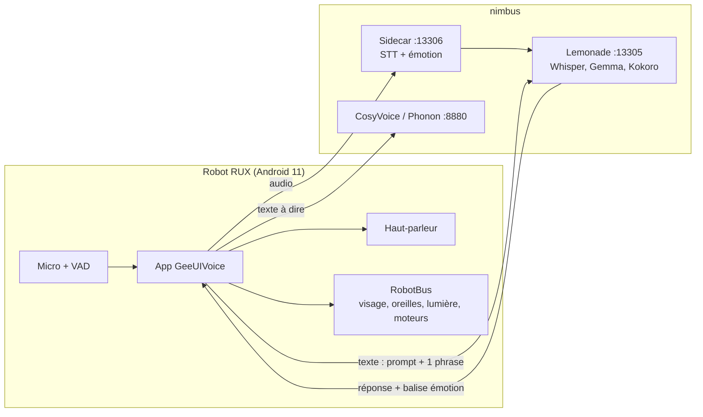
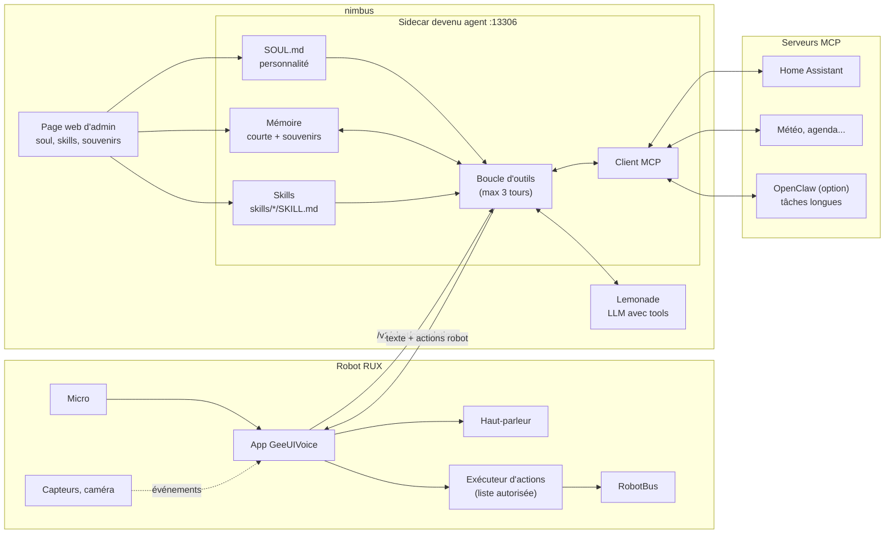
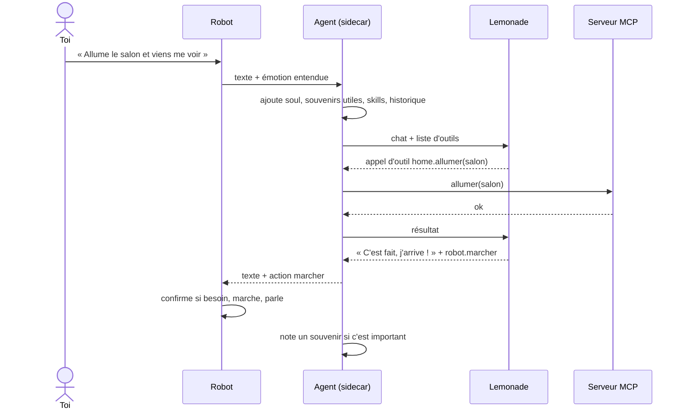

# Donner de l'autonomie au robot : mémoire, outils, skills et soul

Proposition d'architecture, rien n'est encore codé. Principe : la voix reste rapide et locale, le « cerveau » vit sur nimbus dans le sidecar, et tout reste compatible OpenAI.

## 1. Aujourd'hui

Limites : le robot **oublie tout** entre deux phrases (seul le prompt système et la phrase en cours sont envoyés), et il **n'agit** que sur des phrases exactes (« avance », « photo »…).

## 2. Cible

L'app ne change presque pas : elle envoie toujours une requête OpenAI au sidecar et reçoit du texte, plus une liste d'actions robot à exécuter (marcher, visage, lumière…). Tout ce qui est « intelligence » est sur nimbus, donc on peut changer de modèle ou de carte (AMD, NVIDIA, NPU) sans toucher au robot.

## 3. Un tour de conversation

## 4. Mémoire

| Niveau | Contenu | Où | Comment |
|---|---|---|---|
| Courte | Les 6 à 10 derniers échanges | Sidecar, en RAM par session | Ajoutés à chaque requête, oubliés après quelques minutes de silence |
| Souvenirs | Faits durables : prénoms, goûts, habitudes, événements | Sidecar, `memory/` (SQLite ou fichiers) | Outil `retenir(fait)` appelé par le LLM, et résumé automatique en fin de conversation |
| Rappel | Les souvenirs utiles pour la phrase en cours | Sidecar | Recherche simple par mots-clés, puis par embeddings si besoin, injectés dans le prompt |

Tout est consultable et effaçable depuis la page d'admin, et à la voix (« oublie ça »).

## 5. Soul

Un fichier `SOUL.md` sur nimbus remplace le prompt système codé en dur dans l'app : nom du robot, caractère, façon de parler, valeurs, ce qu'il refuse de faire, comment il exprime ses émotions (les balises actuelles restent). On l'édite sans recompiler l'APK.

## 6. Skills

Un skill est un dossier `skills/<nom>/SKILL.md` : une description courte, les étapes, et les outils autorisés. L'agent ne met que les descriptions dans le prompt et ne charge le skill complet que quand il sert, pour rester léger sur un petit modèle.

Création :
- **À la voix** : « Apprends à faire le réveil du matin » → le skill `creer-skill` rédige un brouillon → le robot le relit et demande confirmation → il est enregistré.
- **Page d'admin** : créer, modifier, activer ou désactiver un skill, la soul et les souvenirs.

Un skill créé ne peut utiliser que les outils déjà autorisés : il ne peut pas en ajouter de nouveaux.

## 7. Sécurité

- Jamais exposés au modèle : `reboot`, `shutdown`, ouverture d'apps.
- Confirmation vocale avant de marcher ; refus pendant la charge (déjà en place).
- Serveurs MCP et outils sur liste autorisée, journal de toutes les actions.
- OpenClaw seulement en conteneur, limité au réseau local, sandbox activée, sans skills ClawHub.

## 8. Étapes

1. Tester avec `curl` que le modèle de Lemonade renvoie des `tool_calls`, sinon charger Qwen3-4B-Instruct ou Gemma 4 E4B en GGUF.
2. Sidecar : mémoire courte, `SOUL.md`, outils robot (marcher, visage, volume, photo). L'app passe son chat par le sidecar et exécute les actions reçues.
3. Souvenirs et skills, puis la page d'admin.
4. Client MCP (Home Assistant en premier).
5. Capteurs et caméra ; OpenClaw en option pour les tâches longues.
