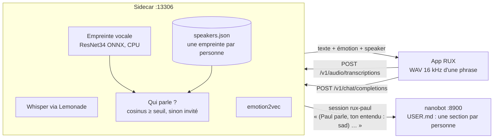
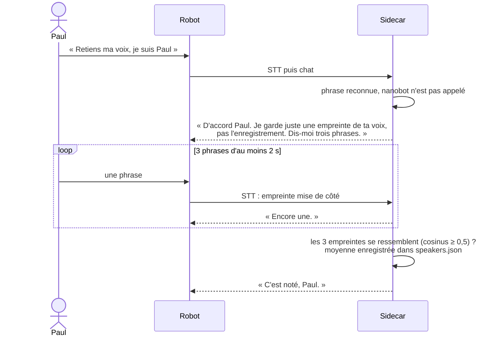
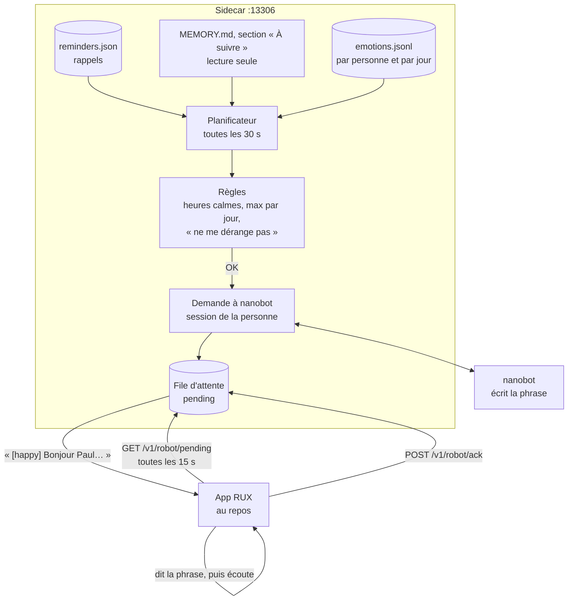
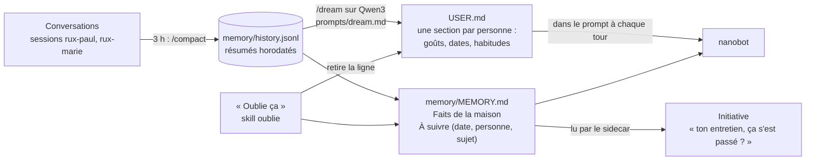

# Rendre RUX plus personnel

Trois chantiers, dans cet ordre :

1. [Reconnaître qui parle](#1-reconnaître-qui-parle)
2. [Prendre l'initiative](#2-prendre-linitiative)
3. [Des souvenirs utiles](#3-des-souvenirs-utiles)

Les autres idées sont dans la [roadmap](ROADMAP.md). L'architecture de départ (sidecar, nanobot, Lemonade) est dans [AGENT.md](AGENT.md).

Les mêmes principes que pour le reste du projet :
- **Le sidecar reste le seul interlocuteur de l'app.** Tout le nouveau code tourne dans `sidecar/` sur nimbus. L'app change le moins possible.
- **On reste compatible OpenAI** : mêmes routes `/v1/audio/transcriptions` et `/v1/chat/completions`, avec seulement des champs ajoutés.
- **On reste agnostique du matériel** : les nouveaux modèles tournent sur le CPU, sans carte particulière.
- **Si une fonction est désactivée, le comportement est le même qu'aujourd'hui.**

Ce qu'on sait de nanobot vient de la lecture de son code (commit `5c72ced`, dans `/workspace/nanobot`). Ça compte pour les trois points :

| Constat | Où dans nanobot | Conséquence |
|---|---|---|
| La mémoire (`USER.md`, `memory/MEMORY.md`, `SOUL.md`, `memory/history.jsonl`) est **une par workspace**, pas une par session. Les sessions (`api:<session_id>`) séparent seulement les conversations. | `agent/memory.py` (`MemoryStore(workspace)`), `api/server.py` L293 | Un `session_id` par personne sépare les conversations, mais pas les souvenirs. Les souvenirs se rangent par personne **à l'intérieur** des fichiers. |
| `nanobot serve` ne lance **ni cron, ni heartbeat, ni Dream planifié**. Seul `gateway` crée le `CronService` et enregistre les tâches `dream` et `heartbeat`. Sans `CronService`, l'outil `cron` n'est même pas chargé. | `cli/commands.py` `serve()` ; `cli/gateway_runtime.py` L577, L919-946 ; `agent/tools/cron.py` L69 | Le robot ne peut pas compter sur nanobot pour parler à heure fixe. C'est le sidecar qui planifie. |
| Le heartbeat de `gateway` envoie ses messages vers un **canal de chat** (Telegram, etc.), jamais vers l'API. | `gateway_runtime.py` L708-760 | Même avec `gateway`, rien n'arriverait jusqu'au robot. |
| Dream ne lit que `memory/history.jsonl`. Une conversation courte n'y arrive qu'après une compaction (`/compact`, contexte trop long, ou compaction après inactivité). Sous `serve`, la boucle qui vérifie l'inactivité (`AgentLoop.run`) ne tourne pas. | `command/builtin.py` L555-570 ; `agent/loop.py` L1386-1420 | Le soir, il faut envoyer `/compact` à chaque session, **puis** `/dream`. |
| Dream n'a le droit d'écrire que dans `SOUL.md`, `USER.md`, `memory/MEMORY.md` et `skills/`. | `memory.py` `build_dream_tools()` L538-578 | Les suivis doivent vivre dans `MEMORY.md`, pas dans un fichier à part. |
| Le prompt de Dream se remplace par `prompts/dream.md` dans le workspace (`/dream-prompt init` en crée une copie), 32 000 caractères au maximum. | `memory.py` L474-504 ; `utils/workspace_prompts.py` | On peut apprendre à Dream à ranger par personne et à noter les suivis avec une date. |
| `AGENTS.md`, `SOUL.md`, `USER.md` et `memory/MEMORY.md` sont mis dans le prompt à chaque tour. | `agent/context.py` L77, L114 | Ce qui est écrit dans `USER.md` sur Paul est connu dès la phrase suivante. |

---

## 1. Reconnaître qui parle

### Objectif

Le robot sait si c'est Paul, Marie ou quelqu'un qu'il ne connaît pas (« invité »). Il appelle chacun par son prénom, garde une conversation par personne, et range les souvenirs au bon nom.

### Le modèle choisi

**`wespeaker_en_voxceleb_resnet34_LM.onnx`**, exécuté avec **sherpa-onnx**.

| | |
|---|---|
| Modèle | ResNet34 de [WeSpeaker](https://github.com/wenet-e2e/wespeaker), affiné « large margin », entraîné sur VoxCeleb2 (5 994 personnes, beaucoup de langues et d'accents) |
| Fichier | [`wespeaker_en_voxceleb_resnet34_LM.onnx`](https://github.com/k2-fsa/sherpa-onnx/releases/download/speaker-recongition-models/wespeaker_en_voxceleb_resnet34_LM.onnx), **25,3 Mo**, sur la [page de modèles de sherpa-onnx](https://github.com/k2-fsa/sherpa-onnx/releases/tag/speaker-recongition-models). Le « en » vient du jeu d'entraînement, le modèle ne dépend pas de la langue des mots |
| Sortie | une empreinte de 256 nombres par phrase |
| Licence du modèle | **CC BY 4.0** (celle de VoxCeleb) : usage libre, il faut citer la source. Voir [la doc WeSpeaker](https://wenet-e2e.github.io/wespeaker/pretrained.html) et [la fiche Hugging Face](https://huggingface.co/Wespeaker/wespeaker-voxceleb-resnet34-LM) |
| Licence du code | WeSpeaker et [sherpa-onnx](https://github.com/k2-fsa/sherpa-onnx) : Apache-2.0 |
| Exécution | `pip install sherpa-onnx numpy` (version 2.0.1 testée). CPU par défaut, CUDA possible. Pas besoin de GPU : environ 80 ms pour 3 s de voix sur un cœur |

Pourquoi lui :
- Il est petit, rapide sur CPU, et très utilisé (c'est le modèle d'empreinte de pyannote).
- sherpa-onnx calcule lui-même les fbank et fournit `SpeakerEmbeddingManager` (ajout, recherche par cosinus). Il n'y a presque rien à coder.
- Il cohabite avec l'`onnxruntime` CPU déjà utilisé par le sidecar pour emotion2vec (testé dans le même venv).

Alternatives possibles, avec le même code :
- `3dspeaker_speech_campplus_sv_en_voxceleb_16k.onnx` (CAM++ de [3D-Speaker](https://github.com/modelscope/3D-Speaker), 28,2 Mo). Le code est en Apache-2.0, mais je n'ai pas pu confirmer la licence des poids sur ModelScope.
- Si sherpa-onnx gêne, on peut passer par `onnxruntime` seul (entrée `feats [B, T, 80]`), avec [kaldi-native-fbank](https://github.com/csukuangfj/kaldi-native-fbank) pour les fbank. Ça demande plus de code.

**Premier test** (sur cette machine, avec les 24 extraits RAVDESS de `sidecar/tests/samples/ravdess`) : on enregistre deux acteurs avec trois phrases calmes chacun, puis on teste toutes les autres phrases contre ces deux empreintes.

| Modèle | Bon acteur (min / moyenne) | Mauvais acteur (max / moyenne) | Seuil 0,5 |
|---|---|---|---|
| ResNet34-LM | 0,17 / 0,59 | 0,44 / 0,30 | 12/17 reconnues, **0/25 confondues** |
| CAM++ | 0,22 / 0,60 | 0,53 / 0,26 | 13/17 reconnues, 1/25 confondue |

Les ratés viennent des phrases jouées avec une émotion forte (colère, peur). Ce sont des acteurs anglophones et des phrases de 3 s : **le seuil doit être réglé sur les vraies voix de la maison**.

### Comment ça marche



1. Dans `_transcribe`, on lance une troisième tâche en parallèle de Whisper et d'emotion2vec : le calcul de l'empreinte sur le même WAV. Il n'y a ni nouvel appel réseau ni nouvel envoi d'audio.
2. On compare l'empreinte à chaque personne enregistrée (cosinus). Le meilleur score gagne s'il est au-dessus de `SPEAKER_THRESHOLD` (0,5 au départ) et devance le deuxième de `SPEAKER_MARGIN` (0,05). Sinon, c'est un invité.
3. Pour qu'une conversation ne saute pas d'une personne à l'autre :
   - une phrase trop courte (moins d'1,2 s : « oui », « non ») garde la dernière personne reconnue ;
   - un score douteux (entre 0,35 et le seuil) garde aussi la dernière personne, si elle a parlé il y a moins de 60 s.
4. Le sidecar garde la personne courante, comme il garde déjà `mood`. Le chat qui suit l'utilise. L'app n'a rien à transmettre, puisqu'elle n'a qu'un micro et qu'un tour suit l'autre.
5. La réponse STT gagne trois champs, ignorés par l'app actuelle : `speaker` (`paul` ou `invite`), `speaker_name` (`Paul`) et `speaker_score`.

### Ce que reçoit nanobot

| Qui | `session_id` | Préfixe du message |
|---|---|---|
| Fonction désactivée, ou personne d'enregistré | `rux` (comme aujourd'hui) | `(ton entendu : sad)` si besoin |
| Paul reconnu | `rux-paul` | `(Paul parle, ton entendu : sad) …` |
| Inconnu | `rux-invite` | `(un invité parle) …` |

Avec une session par personne, la conversation de Paul ne se mélange pas avec celle de Marie, et `/model lourd` ne touche que la session concernée (le verrou par session du sidecar marche tel quel).

**Mémoire** : nanobot n'a qu'une mémoire par workspace (voir le tableau du début). Deux façons de faire :
- **Choix retenu : un workspace partagé, une section par personne.** `USER.md` a une section `## Paul`, une section `## Marie`, etc. (modèle au point 3). C'est le plus simple, et c'est voulu pour un robot de famille : tout le monde sait que l'anniversaire de Marie est le 12 mars. Le préfixe `(Paul parle)` arrive dans l'historique, donc Dream sait à qui rattacher un fait. Il faut le lui demander dans `prompts/dream.md` (point 3).
- **Si on veut une séparation stricte : un nanobot par personne.** Un conteneur par personne (ports 8901, 8902…) avec chacun son workspace, et le sidecar choisit l'URL selon la personne. Les souvenirs sont vraiment séparés, mais il y a N processus, N Dream et des souvenirs communs impossibles. À garder pour plus tard si le besoin apparaît.

**Invités** : `rux-invite`, avec une règle dans `AGENTS.md` et `prompts/dream.md` : « rien de ce que dit un invité n'est noté ». Le soir, on ne compacte pas `rux-invite`. Pour être sûr que rien n'est gardé, `SPEAKER_GUEST_ROUTE=lemonade` envoie les invités directement à Lemonade, sans nanobot (c'est le chemin de secours qui existe déjà). Le vrai mode invité est le point 8 de la roadmap.

### Apprendre une voix, à la voix



Règles :
- Les phrases sont reconnues par le sidecar, avec des expressions régulières en français, avant tout envoi à nanobot. Ça marche même quand nanobot est arrêté. Il y en a trois : « retiens ma voix, je suis X » ou « je m'appelle X, retiens ma voix », puis « oublie ma voix », et enfin « qui suis-je ? » ou « tu me reconnais ? ».
- Le sidecar répond lui-même au format OpenAI (JSON, ou SSE avec `[DONE]` si `stream`), avec une balise d'émotion au début comme le LLM. L'app ne voit pas de différence.
- La phrase de demande elle-même ne sert pas d'échantillon, parce qu'elle contient souvent du bruit ou une hésitation.
- Si les trois phrases ne se ressemblent pas (deux voix, bruit), le robot demande de recommencer.
- On ne peut pas écraser une personne existante sans être reconnu comme elle. Sinon, n'importe qui pourrait dire « je suis Paul ».
- Si on ne dit plus rien pendant 2 minutes, l'enregistrement est abandonné.

### Stockage et vie privée

- `SPEAKERS_FILE` (par défaut `~/.local/share/geeui/speakers.json` sur nimbus, droits `600`) contient, pour chaque personne : son nom, l'empreinte moyenne (256 nombres), le nombre de phrases, la date d'enregistrement et `consent: "voice"`. Le fichier note aussi le nom du modèle. **Aucun audio n'est gardé.** Si le modèle change, il faut réenregistrer.
- Le consentement, c'est la demande elle-même. Le robot dit ce qu'il garde avant de commencer. Personne n'est enregistré à son insu, et un invité n'est jamais enregistré automatiquement.
- « Oublie ma voix » efface l'empreinte de la personne reconnue, et seulement la sienne. Le robot confirme : « J'ai oublié ta voix. » Effacer aussi ses souvenirs, c'est « oublie tout sur moi » (point 3).
- Pour l'administrateur, `GET /v1/speakers` et `DELETE /v1/speakers/<id>` sont protégés par `SIDECAR_ADMIN_KEY`, parce que le port 13306 est ouvert sur le réseau local.

### À modifier

| Fichier | Changement |
|---|---|
| `sidecar/speaker_id.py` (nouveau) | Chargement paresseux de sherpa-onnx, empreinte d'un WAV, recherche (seuil, écart, maintien), enregistrement, suppression, lecture et écriture atomique de `speakers.json`. Si sherpa-onnx ou le modèle manque, la fonction est simplement désactivée |
| `sidecar/emo_server.py` | Troisième tâche dans `_transcribe` ; champs `speaker*` dans la réponse ; état `current_speaker` ; intentions vocales traitées avant `_chat_via_nanobot` ; `session_id` et préfixe selon la personne ; `SPEAKER_GUEST_ROUTE` ; routes `/v1/speakers` |
| `sidecar/requirements-speaker.txt` (nouveau) | `sherpa-onnx`, `numpy` |
| `deploy/nanobot/workspace/SOUL.md` | Expliquer le préfixe « (X parle) » : appeler la personne par son prénom, sans le répéter à chaque phrase |
| `deploy/nanobot/workspace/AGENTS.md` | Règle sur les invités |
| `deploy/nanobot/README.md` | Télécharger le modèle, variables, tests `curl` |
| App | Rien d'obligatoire. En option, afficher `speaker_name` dans le HUD de debug |

Variables : `SPEAKER_MODEL` (chemin du `.onnx`, vide = désactivé), `SPEAKERS_FILE`, `SPEAKER_THRESHOLD=0.5`, `SPEAKER_MARGIN=0.05`, `SPEAKER_STICKY_S=60`, `SPEAKER_MIN_S=1.2`, `SPEAKER_PROVIDER=cpu`, `SPEAKER_THREADS=1`, `SPEAKER_GUEST_ROUTE=nanobot|lemonade`, `SIDECAR_ADMIN_KEY`.

### Tests

- `sidecar/test_speaker.py`, sans modèle : un faux extracteur qui renvoie des vecteurs fixés. Il vérifie le seuil, l'écart, le maintien sur une phrase courte, l'invité, l'enregistrement en 3 phrases, le refus si les phrases ne se ressemblent pas, le refus d'écraser une autre personne, la suppression, l'écriture atomique, et que tout reste comme avant quand `SPEAKER_MODEL` est vide.
- Le même fichier, avec le vrai modèle (ignoré s'il est absent) : les extraits RAVDESS, acteur 01 contre acteur 02.
- `test_nanobot.py` : `session_id` `rux-paul` et préfixe « (Paul parle, ton entendu : …) » envoyés au faux nanobot ; `rux-invite` ou Lemonade pour un invité.
- Sur le robot : enregistrer deux personnes, puis 20 phrases chacune à 1 m et à 3 m, ventilateur allumé. Noter les scores et régler `SPEAKER_THRESHOLD`.

### Vérifié / non vérifié

Vérifié :
- Les fichiers du modèle existent et ont les tailles indiquées (ResNet34-LM 25,3 Mo, CAM++ 28,2 Mo). sherpa-onnx 2.0.1 les charge sur CPU. Empreintes de 256 et 512 nombres.
- sherpa-onnx et `onnxruntime` 1.31 (CPU) se chargent dans le même processus.
- Scores sur RAVDESS (tableau plus haut), et environ 80 ms par phrase de 3,3 s.
- La mémoire nanobot est une par workspace (lecture du code).

Non vérifié :
- Les vraies voix françaises, le micro du robot, la distance, le bruit : le seuil est à régler.
- sherpa-onnx à côté d'`onnxruntime-gpu` ou ROCm dans le même processus (le test était en CPU).
- La licence des poids CAM++ (3D-Speaker).
- Que Dream range bien les faits par personne grâce au préfixe : à tester avec le vrai Qwen3.
- La charge CPU de nimbus quand Whisper, emotion2vec et l'empreinte tournent en même temps.

---

## 2. Prendre l'initiative

### Objectif

Le robot parle le premier quand c'est utile :
- un bonjour le matin, quand il entend pour la première fois de la journée une personne connue ;
- les rappels qu'on lui a demandés (« rappelle-moi dans une heure de sortir le linge ») ;
- les suivis notés en mémoire (« ton entretien de mardi, ça s'est passé comment ? », point 3) ;
- une attention discrète si quelqu'un semble tendu plusieurs jours de suite.

Et il ne doit jamais devenir pénible : un nombre maximal de prises de parole, des heures calmes, « ne me dérange pas ».

### Pourquoi pas le cron ou le heartbeat de nanobot

Lu dans le code (tableau du début) : sous `serve`, nanobot n'a ni cron, ni heartbeat, ni outil `cron`. Sous `gateway`, le heartbeat existe, mais il parle à un canal de chat, pas au robot. **C'est donc le sidecar qui décide quand parler. nanobot écrit seulement le texte**, dans la session de la personne, avec sa soul et ses souvenirs.

### Comment ça marche



**Le canal vers le robot** : l'app interroge le sidecar quand elle est au repos (`GET /v1/robot/pending`, toutes les 15 s). C'est le plus simple. Pas de connexion à maintenir, pas de port ouvert sur le robot, et ça marche aussi après une coupure du Wi-Fi.

```json
{"items": [{"id": "a1b2", "kind": "followup", "person": "paul",
            "text": "[happy] Salut Paul ! Ton entretien de mardi, ça s'est passé comment ?",
            "expires_at": "2026-11-12T12:00:00+01:00"}]}
```

L'app :
1. ne lit `pending` que si elle n'est ni en train d'écouter, ni en train de parler, ni en veille, ni en mode `sleep` ;
2. dit le texte avec le chemin habituel (balise d'émotion, visage, voix) ;
3. envoie `POST /v1/robot/ack {"id": "a1b2", "status": "spoken"}`. Si elle n'a pas pu le dire (occupée, mode `sleep`), elle envoie `"skipped"` ;
4. laisse le micro ouvert quelques secondes. La réponse part dans la session de la personne, qui reste la personne courante du sidecar pendant 60 s.

Une phrase périmée (`expires_at` passé) est jetée, jamais dite en retard.

**La phrase elle-même** : le sidecar envoie à nanobot, dans la session de la personne, un message qui commence par `(initiative de RUX, personne n'a parlé)` et donne la consigne. Par exemple : « Dis bonjour à Paul en une phrase. Rappelle-lui son entretien de demain s'il y en a un. » nanobot répond avec sa soul et ce qu'il sait de Paul. Si nanobot ne répond pas, le sidecar a des phrases toutes faites (« Bonjour Paul ! »).

### Les déclencheurs

| Déclencheur | Quand | Détail |
|---|---|---|
| Bonjour | Première phrase d'une personne connue après `GREETING_FROM` (6 h) | Le salut n'est pas mis en file. Le sidecar ajoute la consigne « commence par saluer Paul, c'est la première fois aujourd'hui » à ce premier tour. Le robot ne parle donc pas à une pièce vide. Plus tard, un toucher (`onTapResponse`) ou le capteur ToF pourront servir de « présence » (`POST /v1/robot/event`), mais leurs libellés ne sont pas encore vérifiés sur le robot |
| Rappel | À l'heure demandée | nanobot écrit une balise `[rappel:2026-11-10T19:30|sortir le linge]` à la fin de sa réponse. Le sidecar la lit dans le flux qu'il relaie déjà et l'enregistre dans `reminders.json`. L'app ignore et retire les balises inconnues (règle d'AGENT.md). Valable 30 min après l'heure |
| Suivi | Le jour indiqué dans `MEMORY.md`, à la première présence de la personne | Les lignes de la section « À suivre » (format au point 3). Chaque suivi n'est posé qu'une fois : son identifiant (hachage de la ligne) va dans `initiative_state.json` |
| Tension | Après au moins 3 jours de suite où plus de 40 % des phrases d'une personne (sur au moins 10) sont `sad`, `angry` ou `fear` avec une confiance ≥ 0,6 | Au plus une fois par semaine et par personne. Une phrase douce, jamais un diagnostic : « Tu as l'air un peu sous pression ces jours-ci. Tu veux en parler ? ». La fatigue n'est pas une émotion d'emotion2vec, elle n'est pas détectée |

### Les garde-fous (dans le sidecar, pas dans le modèle)

- `INITIATIVE_MAX_PER_DAY=4` par personne, et au moins `INITIATIVE_MIN_GAP_MIN=90` minutes entre deux initiatives. Les rappels demandés ne comptent pas dans ces limites.
- Heures calmes : `QUIET_HOURS=21:30-08:00`. Seuls les rappels demandés passent.
- « Ne me dérange pas », « tais-toi jusqu'à demain », « silence pendant deux heures » : le sidecar comprend la phrase lui-même et coupe les initiatives (sauf les rappels) jusqu'à l'heure dite, ou jusqu'au lendemain 8 h par défaut. « Tu peux reparler » les remet en route.
- Jamais d'initiative pendant un invité, ni en mode enfant (roadmap, point 8).
- `INITIATIVE_ENABLED=0` (par défaut) : rien ne change.

### Le soir, toujours dans le sidecar

À `NIGHTLY_AT=03:00`, le sidecar envoie `/compact` à chaque session `rux-<personne>` (sauf `rux-invite`), puis un seul `/dream`. Ça remplace le cron système prévu dans `deploy/nanobot/README.md`. C'est ce qui fait entrer les conversations courtes dans la mémoire (voir le tableau du début).

### Météo et agenda (plus tard)

C'est facultatif, via un serveur MCP dans `tools.mcpServers` de nanobot (`enabledTools` réduit au strict nécessaire, URL du réseau local dans `tools.ssrfWhitelist`). Par exemple un serveur météo basé sur Open-Meteo, ou un CalDAV pour l'agenda. Le serveur reste à choisir et à tester. Le bonjour du matin demandera alors « la météo du jour en une phrase » à nanobot. Sans MCP, le bonjour reste un simple bonjour.

### À modifier

| Fichier | Changement |
|---|---|
| `sidecar/initiative.py` (nouveau) | Planificateur (thread), règles, file `pending`, `reminders.json`, `initiative_state.json`, lecture de la section « À suivre », statistiques d'émotion, tâche du soir |
| `sidecar/emo_server.py` | Routes `GET /v1/robot/pending`, `POST /v1/robot/ack`, `POST /v1/robot/event` ; lecture des balises `[rappel:…]` dans le flux nanobot ; phrases « ne me dérange pas » ; consigne de bonjour au premier tour ; écriture de `emotions.jsonl` dans `_transcribe` |
| `deploy/nanobot/workspace/AGENTS.md` | La balise `[rappel:AAAA-MM-JJTHH:MM|texte]` : quand et comment l'écrire, une seule par réponse, avec l'heure en absolu. Comment répondre à un message « (initiative de RUX…) » |
| `deploy/nanobot/README.md` | Monter le workspace en lecture pour le sidecar (`NANOBOT_WORKSPACE=…/data/workspace`). Retirer le cron système `/dream` |
| App, `Loop.kt` et `VoiceSession` | Interroger `pending` au repos, dire le texte, `ack`, garder le micro ouvert. Réglage pour couper la fonction |

Variables : `INITIATIVE_ENABLED`, `INITIATIVE_MAX_PER_DAY`, `INITIATIVE_MIN_GAP_MIN`, `QUIET_HOURS`, `GREETING_FROM`, `NIGHTLY_AT`, `NANOBOT_WORKSPACE`, `INITIATIVE_STATE_DIR`.

### Tests

- `sidecar/test_initiative.py` avec une horloge simulée : heures calmes, maximum par jour, écart minimal, « ne me dérange pas » avec et sans durée, expiration, un suivi posé une seule fois, seuil de tension sur 3 jours, rappel qui passe pendant les heures calmes.
- Balise `[rappel:…]` coupée entre deux morceaux SSE et quand même enregistrée. Balise avec une date passée ou mal formée : ignorée.
- `pending` vide quand `INITIATIVE_ENABLED=0`.
- Tâche du soir : `/compact` envoyé à `rux-paul` et `rux-marie` mais pas à `rux-invite`, puis `/dream` (faux nanobot).
- App : test de `VoiceSession` avec un faux sidecar. Pas de lecture de `pending` pendant un tour, `ack` envoyé après la phrase.

### Vérifié / non vérifié

Vérifié par la lecture du code de nanobot :
- `serve` n'a ni cron, ni heartbeat, ni Dream planifié ; l'outil `cron` n'est pas chargé sans `CronService`.
- Le heartbeat de `gateway` livre à un canal de chat.
- Sous `serve`, la compaction des sessions inactives ne tourne pas.

Non vérifié :
- Qu'un `/compact` envoyé par l'API rende la main proprement (la commande ne renvoie pas de texte ; l'API met peut-être une réponse par défaut).
- Que Gemma écrive correctement la balise `[rappel:…]` avec une date absolue (il faudra peut-être passer par Qwen3, ou faire calculer la date par le sidecar).
- Le capteur ToF et le toucher comme signes de présence.
- Le rythme d'interrogation (15 s) et la consommation sur le robot.
- Un serveur MCP météo ou agenda.

---

## 3. Des souvenirs utiles

### Objectif

Le robot se souvient de ce qui compte pour chacun : les dates importantes, les goûts, et ce qui est en cours, pour y revenir au bon moment. On peut lui faire oublier quelque chose à la voix.

### Comment ça marche



### Ranger les fichiers

On donne à `USER.md` et `memory/MEMORY.md` une structure fixe. Dream la garde, si on le lui demande dans son prompt.

`USER.md` :

```markdown
# Les gens de la maison

## Paul
- Prénom : Paul. Tutoiement.
- Dates : anniversaire le 4 juin.
- Goûts : aime le jazz, déteste la coriandre.
- Habitudes : télétravail le lundi et le vendredi.

## Marie
- Dates : anniversaire le 12 mars.
- Goûts : …

## Règles
- Rien n'est noté sur les invités.
```

`memory/MEMORY.md` :

```markdown
# Mémoire de RUX

## Faits de la maison
- Le chat s'appelle Luna.

## À suivre
- 2026-11-17 | Paul | entretien d'embauche chez Dupont | demander comment ça s'est passé
- 2026-11-20 | Marie | rendez-vous chez le dentiste | demander si ça va
```

Le format des lignes « À suivre » est **strict**, parce que le sidecar le lit (point 2) : `- AAAA-MM-JJ | Prénom | sujet | quoi faire`. Le sidecar ignore une ligne mal formée.

### Le prompt de Dream

On crée `prompts/dream.md` dans le workspace (`/dream-prompt init` fait une copie du prompt par défaut). On garde le texte d'origine et on ajoute une section RUX :

```markdown
## Règles de RUX

- Chaque message commence par « (Paul parle) », « (Marie parle) » ou « (un invité parle) ».
  Range chaque fait dans la section de cette personne dans USER.md.
  N'écris jamais rien qui vient d'un invité.
- Garde la structure de USER.md et de memory/MEMORY.md telle quelle (titres et ordre).
- Dates importantes (anniversaires, fêtes, rendez-vous réguliers) : ligne « Dates » de la personne.
- Événement futur dont on voudra des nouvelles (entretien, examen, voyage, rendez-vous médical) :
  ajoute une ligne dans « ## À suivre » au format exact
  « - AAAA-MM-JJ | Prénom | sujet | quoi faire ».
  Calcule la date absolue à partir de l'horodatage de l'historique (« mardi » = le mardi suivant).
  La date est le lendemain de l'événement.
- Retire une ligne « À suivre » quand la personne a donné des nouvelles, ou 7 jours après sa date.
- Si quelqu'un a demandé d'oublier quelque chose, ne le réécris jamais, même s'il est encore dans l'historique.
- Écris en français.
```

Le message système de Dream reste en anglais, puisqu'on garde le texte d'origine. Seule la section ajoutée est en français.

### Règles pour la conversation (`AGENTS.md`)

- « Quand on te parle d'un événement à venir, réponds normalement. Il sera noté le soir. Si la personne demande explicitement un rappel à une heure précise, écris la balise `[rappel:…]` (point 2). »
- « Quand un message commence par (initiative de RUX…), tu parles le premier : une phrase, chaleureuse, sans insister. Si la personne ne veut pas en parler, n'y reviens pas. »
- « Ne cite pas tes souvenirs à chaque phrase. Sers-t'en quand c'est utile. »

### « Oublie ça »

Un skill du workspace, `skills/oublie/SKILL.md`, avec en description : « quand quelqu'un dit "oublie ça", "oublie que…", "ne retiens pas…" ». nanobot a l'outil fichier, limité au workspace, et peut donc modifier `USER.md` et `MEMORY.md` pendant le tour :
1. Il retrouve le fait. Pour « oublie ça », c'est le dernier fait dit par la personne.
2. Il le redit en une phrase et demande « je l'oublie ? ».
3. Si la réponse est « oui », il retire la ligne de `USER.md` ou `MEMORY.md` et ne touche qu'à la section de la personne qui parle. Un invité ne peut rien faire oublier.
4. La règle de `prompts/dream.md` empêche Dream de le réécrire.

« Oublie tout sur moi » : le sidecar retire l'empreinte vocale (point 1), et nanobot retire la section de la personne dans `USER.md` et ses lignes « À suivre », après une confirmation.

**Limite à dire clairement** : le texte reste dans `sessions/`, `memory/history.jsonl` et l'historique git du workspace (chaque Dream y fait un commit). Pour un vrai effacement, il faut une étape d'administration sur nimbus : `/new` sur la session, nettoyage de `history.jsonl`, et le git du workspace à réécrire ou à supprimer. À documenter dans `deploy/nanobot/README.md`.

### Lien avec l'initiative

Les lignes « À suivre » sont la principale source du point 2. Dream les écrit la nuit. Le sidecar les lit et pose la question à la première présence de la personne le jour J. Dream retire la ligne quand la personne a répondu. C'est tout le cycle de « tu avais un entretien mardi, ça s'est passé comment ? ».

### À modifier

| Fichier | Changement |
|---|---|
| `deploy/nanobot/workspace/USER.md` (nouveau) | Le squelette par personne |
| `deploy/nanobot/workspace/memory/MEMORY.md` (nouveau) | Les sections « Faits de la maison » et « À suivre » |
| `deploy/nanobot/workspace/prompts/dream.md` (nouveau) | Prompt Dream par défaut, plus la section RUX |
| `deploy/nanobot/workspace/skills/oublie/SKILL.md` (nouveau) | Le skill d'oubli |
| `deploy/nanobot/workspace/AGENTS.md` | Les règles ci-dessus |
| `deploy/nanobot/README.md` | Copier ces fichiers ; effacement complet ; tâche du soir faite par le sidecar |
| `sidecar/initiative.py` | Lecture de « À suivre » (déjà au point 2) |

### Tests

- Lecture des lignes « À suivre » : bonnes lignes, lignes mal formées, dates passées ou futures, prénoms avec accents.
- Sur nimbus, avec Qwen3 et un faux historique : « (Paul parle) J'ai un entretien mardi chez Dupont ». Après `/compact` et `/dream`, on vérifie que `USER.md` et `MEMORY.md` gardent leur structure, que la ligne « À suivre » a la bonne date, et que rien n'est noté pour un invité. `/dream-log` pour voir le changement, `/dream-restore` pour revenir en arrière.
- « Oublie que j'aime le jazz » : la ligne disparaît, et elle ne revient pas après un nouveau `/dream`.

### Vérifié / non vérifié

Vérifié par la lecture du code de nanobot :
- La mémoire est une par workspace ; les quatre fichiers sont dans le prompt à chaque tour.
- Dream ne peut écrire que `SOUL.md`, `USER.md`, `memory/MEMORY.md` et `skills/`.
- `prompts/dream.md` remplace le prompt de Dream ; `/dream-prompt init` en crée une copie.
- Dream ne lit que `history.jsonl`, d'où `/compact` avant `/dream`.

Non vérifié :
- Que Qwen3 4B suive la structure, le format « À suivre » et le calcul des dates (le plus risqué ; sinon, un modèle plus gros pour Dream seulement).
- Que le préfixe « (Paul parle) » survive au résumé de la compaction.
- Que le skill `oublie` soit choisi de façon fiable par Gemma (sinon, le sidecar reconnaît « oublie » et force `/model lourd`).
- L'effacement complet, git compris.
