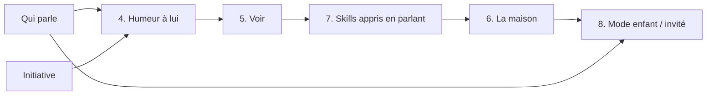

# Roadmap de RUX

## Déjà fait ou en cours

| | État |
|---|---|
| #4 Émotions dans la boucle vocale | fusionnée |
| [#5](https://github.com/ogrums/GeeUIVoice/pull/5) Visages d'écoute et de parole | PR ouverte |
| [#6](https://github.com/ogrums/GeeUIVoice/pull/6) Voix accentuée selon l'émotion | PR ouverte |
| [#7](https://github.com/ogrums/GeeUIVoice/pull/7) Voix Phonon (Gradium) | PR ouverte |
| [#8](https://github.com/ogrums/GeeUIVoice/pull/8) Architecture agent avec nanobot ([AGENT.md](AGENT.md)) | PR ouverte |
| [#9](https://github.com/ogrums/GeeUIVoice/pull/9) Sidecar : conversation via nanobot, Gemma et Qwen3 | PR ouverte |

**En cours d'étude**, dans [PERSONNALISATION.md](PERSONNALISATION.md) :
1. [Reconnaître qui parle](PERSONNALISATION.md#1-reconnaître-qui-parle)
2. [Prendre l'initiative](PERSONNALISATION.md#2-prendre-linitiative)
3. [Des souvenirs utiles](PERSONNALISATION.md#3-des-souvenirs-utiles)

## Ensuite, dans cet ordre

Effort : **S** = quelques heures, **M** = quelques jours, **L** = une semaine ou plus.

### 4. Une humeur à lui

- **Objectif** : RUX a sa propre humeur, qui change lentement. Il est content quand on lui parle, il s'ennuie ou boude un peu quand on l'ignore longtemps. Elle se voit sur le visage au repos, s'entend dans la voix et se lit dans les gestes. Il paraît plus vivant que s'il réagissait toujours pareil.
- **Mise en œuvre** :
  - Le sidecar garde une deuxième humeur, celle du robot. Le `mood` qui existe déjà est l'émotion entendue chez la personne, avec une demi-vie de 45 s.
  - Celle du robot a deux valeurs : contentement et énergie, avec une demi-vie de quelques heures. Elles bougent avec les événements : conversation, compliment, longue absence, nuit, ton entendu.
  - Le sidecar l'expose en `GET /v1/robot/mood` et l'ajoute au préfixe envoyé à nanobot : « (humeur de RUX : un peu boudeur) ».
  - L'app choisit le visage au repos, la voix (Kokoro, CosyVoice ou Phonon via `TtsRoute`) et les gestes de `SdkMap` selon cette humeur. Les règles restent dans le code, pas dans le modèle.
- **Dépendances** : point 1 (savoir qui est là) et point 2 (le canal d'initiative, pour un « tu m'as manqué »). PR #5 et #6 pour les visages et la voix.
- **Effort** : M.
- **Non vérifié** : quels visages `hNNNN` collent à une humeur de repos ; qu'une humeur boudeuse ne devienne pas agaçante (à régler à l'usage).

### 5. Voir

- **Objectif** : « qu'est-ce que tu vois ? », lire un papier, reconnaître un objet, et plus tard un visage connu.
- **Mise en œuvre** :
  - L'app prend une photo (la balise `[photo]` et `takePhoto` existent déjà) et l'envoie au sidecar : `POST /v1/robot/see`, en JPEG.
  - Le sidecar demande une description à un modèle vision de Lemonade, au format OpenAI (`image_url` en data URL). Le texte obtenu part ensuite dans la conversation nanobot : « (RUX voit : …) ».
  - L'API de nanobot accepte aussi les images en data URL. Mais il faudrait un preset vision, et le modèle FLM actuel n'en est pas un.
  - Modèles vision listés par Lemonade (`server_models.json`, version du 7 novembre 2026), tous en GGUF via llama.cpp, donc CPU, Vulkan, ROCm ou CUDA :

    | Modèle Lemonade | Taille | Étiquettes |
    |---|---|---|
    | `Gemma-4-E2B-it-GGUF` | 4,1 Go | chat, tool-calling, vision |
    | `Qwen3-VL-4B-Instruct-GGUF` | 3,3 Go | chat, vision |
    | `Qwen2.5-VL-3B-Instruct-GGUF` | 3,3 Go | chat, vision |
    | `Gemma-3-4b-it-GGUF` | 3,3 Go | chat, vision |
    | `LFM3-VL-2B-GGUF` | 1,5 Go | chat, reasoning, vision |

  - Piste intéressante : `Gemma-4-E2B-it-GGUF` est à la fois vision et tool-calling. Il pourrait remplacer le preset `rapide` FLM et servir pour la vue. On aurait un modèle de moins à charger, mais il ne tourne pas sur le NPU.
  - Sinon, `max_loaded_models=3`.
  - Les visages connus : le robot a déjà `com.ltp.ident` (reconnaissance faciale du fabricant). À regarder avant d'ajouter un modèle.
- **Dépendances** : point 1, pour savoir à qui on répond. Vie privée : une photo n'est prise que sur demande, et elle n'est pas gardée.
- **Effort** : L.
- **Non vérifié** : la qualité en français et la latence de chaque modèle sur nimbus ; la résolution et l'orientation de la caméra ; l'accès à `com.ltp.ident` depuis l'app.

### 7. Des skills appris en parlant

- **Objectif** : « Quand je dis bonne nuit, éteins la lumière de l'antenne et parle tout bas. » Ça devient un skill, validé par un humain avant d'être actif.
- **Mise en œuvre** :
  - `AGENTS.md` prévoit déjà `skill-creator` et le « je l'enregistre ? ».
  - Pour la validation, nanobot écrit le skill dans `brouillons/<nom>/SKILL.md`, un dossier du workspace que nanobot ne charge pas comme skill.
  - Une petite page d'admin sur le sidecar (`/admin/skills`, protégée par `SIDECAR_ADMIN_KEY`) liste les brouillons. Elle montre le texte, et les boutons Valider (déplacer dans `skills/`) et Refuser.
  - Un skill ne peut utiliser que les balises d'action autorisées. La page le vérifie avant de valider.
  - Dream peut aussi créer des skills directement dans `skills/` (son prompt par défaut le prévoit). Il faut le lui interdire dans `prompts/dream.md` (« propose un brouillon dans brouillons/ ») ou relire ce qu'il a fait avec `/dream-log`.
- **Dépendances** : la PR #9 déployée ; idéalement le point 1, pour savoir qui a demandé le skill.
- **Effort** : M.
- **Non vérifié** : que nanobot relise `skills/` à chaque tour sans redémarrage (le code semble le faire) ; que Gemma suive `skill-creator` (sinon, `/model lourd`).

### 6. La maison

- **Objectif** : « allume le salon », « il fait combien dans la chambre ? », « qui est à la maison ? ».
- **Mise en œuvre** :
  - Home Assistant a sa propre intégration [Model Context Protocol](https://www.home-assistant.io/integrations/mcp_server/) (depuis 2025.2). L'URL `/api/mcp/assist` (« Device control ») n'expose que les entités ouvertes à l'assistant vocal, et c'est la seule URL qui ne demande pas un compte administrateur. On l'ajoute dans `tools.mcpServers` de nanobot (`url`, `headers` avec le jeton). Son IP va dans `tools.ssrfWhitelist` (par exemple `"192.168.1.50/32"`), et `enabledTools` ne garde que les outils voulus.
  - On commence en lecture seule, puis on ajoute les commandes.
  - Une confirmation à la voix pour ce qui ouvre ou chauffe (volets, serrure, chauffage). La règle va dans `AGENTS.md`, et si possible on ne l'expose pas du tout.
- **Dépendances** : la PR #9 déployée ; le point 1, pour que seuls les gens de la maison puissent commander (pas les invités).
- **Effort** : M.
- **Non vérifié** : la connexion avec un jeton longue durée (la doc de Home Assistant décrit surtout OAuth) ; le transport accepté par le client MCP de nanobot ; la latence d'un aller-retour outil avec Gemma.

### 8. Mode enfant / invité

- **Objectif** : quand c'est un enfant ou un invité qui parle, moins d'actions possibles, des réponses adaptées, et aucune mémoire écrite sur les invités.
- **Mise en œuvre** :
  - Le profil vient du point 1. `speakers.json` gagne un champ `role` : `adulte`, `enfant` ou `invite`. Un inconnu est toujours `invite`.
  - Le sidecar applique les règles :
    - **invité** : envoyé directement à Lemonade (`SPEAKER_GUEST_ROUTE=lemonade`, rien n'est écrit) ou à `rux-invite` sans compaction ; pas d'initiative ; pas de balises de marche ni de maison ;
    - **enfant** : session `rux-<prénom>` ; préfixe « (Léa parle, c'est une enfant) » ; la soul adapte le vocabulaire ; pas de maison ; marche avec confirmation d'un adulte.
  - L'app filtre les balises d'action selon un champ `allowed_actions` que le sidecar ajoute à la réponse. Le filtre est dans le code, pas dans le modèle.
- **Dépendances** : points 1 et 6.
- **Effort** : M.
- **Non vérifié** : la fiabilité de la reconnaissance de la voix des enfants (elle change avec l'âge, il faudra réenregistrer) ; qu'un invité ne puisse pas se faire passer pour un adulte enregistré (le seuil compte beaucoup ici).
